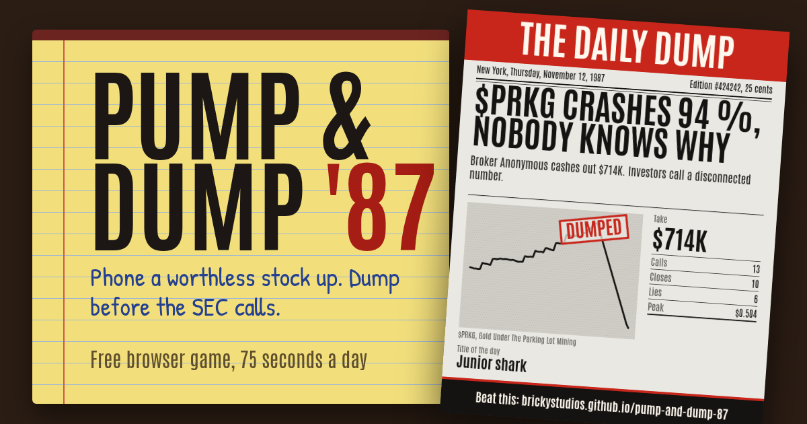
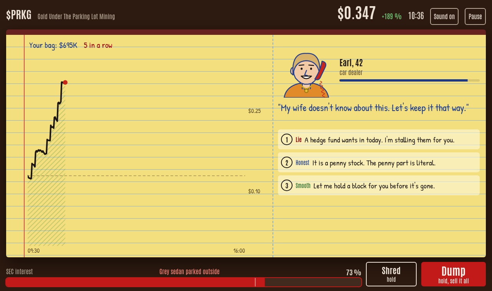
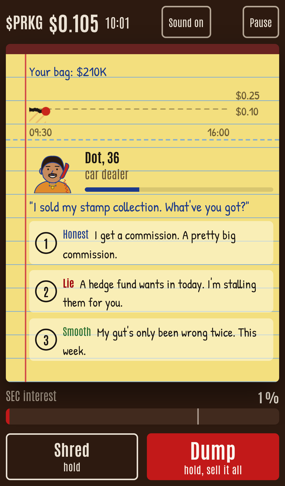

<div align="center">

# Pump & Dump '87: a penny stock browser game

<a href="https://brickystudios.github.io/pump-and-dump-87/"></a>

<br><br>

[](https://brickystudios.github.io/pump-and-dump-87/)


**Phone a worthless penny stock up, lie to the right callers, and dump before the SEC raids your 1987 boiler room.**

</div>

## How to play

A trading day lasts 75 seconds. The phone rings, a caller asks something, and you pick one of three script lines: honest, smooth or a lie.

- A close pushes the price up. Lies push it furthest and fill the red SEC bar fastest.
- Some callers are investigators. Lie to one and the bar jumps by a third.
- Hold **S** (or the Shred button) to shred files and cool the bar down. Every bag takes longer than the last.
- Hold **D** (or Dump) to sell everything at the current price. That ends the day.
- At 100 % SEC interest you get raided and keep nothing. If you never dump, the stock is halted at 16:00 and you keep nothing too.

Keys: 1, 2, 3 to answer, M for sound, P to pause. On a phone you tap.

## The front page

Every day ends on a tabloid front page with your name, the ticker, the chart and what you made. You can share it as an image, copy a text version with a block chart, or send a challenge link that shows your take to whoever opens it.

<p align="center">
  
  
</p>

Everyone gets the same company each day, so scores are comparable. Free play deals a random one. The game speaks German or English, picked from your browser.

## Run it locally

```bash
git clone https://github.com/BrickyStudios/pump-and-dump-87.git
cd pump-and-dump-87
python3 -m http.server 8000
```

Then open http://localhost:8000. Every tuning value (gains, heat, odds, timers) sits in `config.js`.

## Fine print

Satire. The companies, tickers and callers are made up, and nothing here is financial advice. Pump and dump schemes are fraud.

Made with [Claude Code Game Studios](https://github.com/Donchitos/Claude-Code-Game-Studios). Fonts: Antonio and Patrick Hand from Google Fonts (SIL Open Font License). Code under the MIT license.
